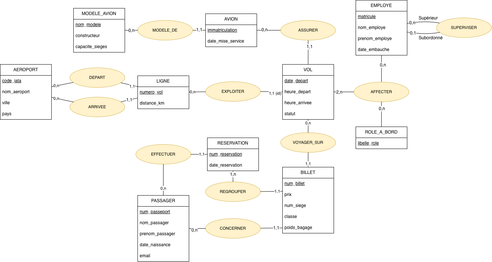
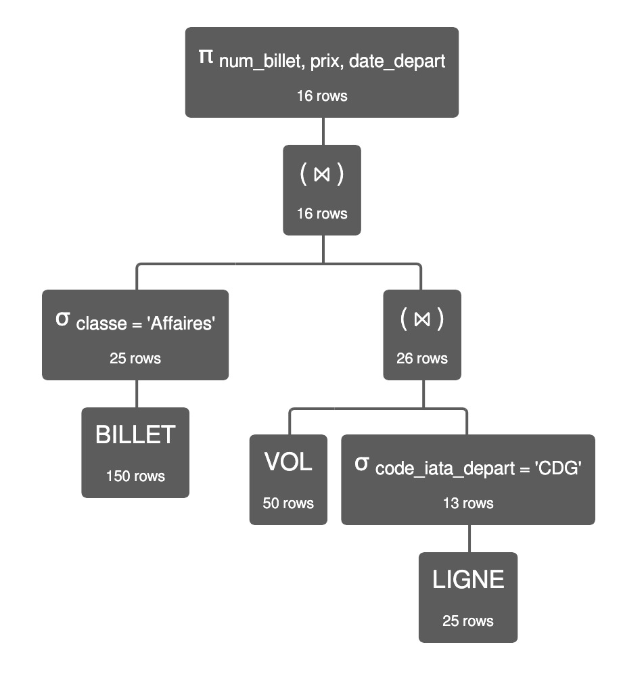

# Mini-projet TI503N : Base de données d'une compagnie aérienne

**Module** : TI503N – Bases de données 1 : Concepts de base (EFREI)
**Partie 1** : analyse des besoins et MCD


## Étape 1 : Analyse des besoins

### 1.1 Prompt final (framework RICARDO)

Le prompt part de la base fournie. Seules les parties **Contexte** et **Références** ont été complétées. Le même texte est disponible dans `prompt.txt`.

```text
Tu travailles dans le domaine des compagnies aériennes. Ta compagnie a comme activité d’organiser des vols de passagers (court, moyen et long-courrier) entre différents aéroports, avec une flotte d’avions, des équipages et un système de réservation et de vente de billets. C’est une compagnie comme Air France, Ryanair, Air India ou Delta. Inspire-toi des sites web suivants : https://www.airfrance.fr, https://www.ryanair.com, https://www.airindia.com, https://www.delta.com.
Ta compagnie veut appliquer MERISE pour concevoir un système d'information. Tu es chargé de la partie analyse, c’est-à-dire de collecter les besoins auprès de l’entreprise. Elle a fait appel à un étudiant en ingénierie informatique pour réaliser ce projet, tu dois lui fournir les informations nécessaires pour qu’il applique ensuite lui-même les étapes suivantes de conception et développement de la base de données.
D’abord, établis les règles de gestions des données de la compagnie sous la forme d'une liste à puce. Elle doit correspondre aux informations que fournit quelqu’un qui connaît le fonctionnement de l’entreprise, mais pas comment se construit un système d’information.
Ensuite, à partir de ces règles, fournis un dictionnaire de données brutes avec les colonnes suivantes, regroupées dans un tableau : signification de la donnée, type, taille en nombre de caractères ou de chiffres. Il doit y avoir entre 25 et 35 données. Il sert à fournir des informations supplémentaires sur chaque donnée (taille et type) mais sans a priori sur comment les données vont être modélisées ensuite.
Fournis donc les règles de gestion et le dictionnaire de données.
```

### 1.2 Règles de gestion

**Flotte**

- La compagnie possède des avions. Chaque avion est identifié par son immatriculation (ex. F-HBXA) et a une date de mise en service.
- Chaque avion appartient à un modèle (ex. A320, Boeing 777). Un modèle a un constructeur et une capacité en nombre de sièges. Tous les avions d'un même modèle ont la même capacité.

**Aéroports et lignes**

- La compagnie dessert des aéroports, identifiés par leur code IATA de 3 lettres (ex. CDG, JFK). Un aéroport a un nom, une ville et un pays.
- Une ligne relie un aéroport de départ à un aéroport d'arrivée différent. Elle est identifiée par son numéro de vol (2 lettres suivies de 1 à 4 chiffres, ex. AF7) et a une distance en km.

**Vols**

- Une ligne est exploitée régulièrement. Un vol correspond à l'exploitation d'une ligne à une date précise : on le désigne par le numéro de vol et la date de départ (ex. AF7 du 12/03/2026). Le même numéro de vol ne peut pas avoir deux départs le même jour.
- Un vol a une heure de départ prévue, une heure d'arrivée prévue et un statut (Prévu, Retardé, Annulé ou Effectué).
- Un vol est assuré par un seul avion. Un avion assure plusieurs vols, mais jamais deux en même temps.

**Personnel**

- Chaque employé a un matricule, un nom, un prénom, et une date d'embauche.
- Chaque employé a un supérieur hiérarchique, qui est lui-même un employé. Seul le directeur des opérations n'en a pas.
- Pour chaque vol, plusieurs employés sont affectés à bord. Chacun y tient un rôle précis (commandant de bord, officier pilote de ligne, chef de cabine, personnel de cabine). Un même employé peut avoir des rôles différents d'un vol à l'autre, mais un seul rôle sur un vol donné.
- Un vol doit avoir au moins un commandant de bord et un officier pilote de ligne.

**Passagers, réservations et billets**

- Un passager est identifié par son numéro de passeport. On enregistre son nom, son prénom, sa date de naissance et son email.
- Une réservation est faite par un passager. Elle a un numéro de 6 caractères et une date de réservation. Une réservation peut regrouper plusieurs billets (famille, amis), mais elle est toujours au nom d'un seul passager.
- Un billet est identifié par un numéro de 13 chiffres. Il concerne un seul passager, sur un seul vol, dans une seule classe de voyage. Il a un prix payé et un numéro de siège.
- Sur un vol donné, un siège ne peut être attribué qu'à un seul billet.
- Les classes de voyage sont Économique, Premium, Affaires et Première. Chaque billet a une classe et un poids de bagage en soute (en kg), choisi par le passager : il peut prendre un bagage plus léger que ce que sa classe autorise.

### 1.3 Dictionnaire de données

| N° | Signification de la donnée | Type | Taille |
|---:|---|---|---|
| 1 | Immatriculation de l'avion | Texte | 6 caractères |
| 2 | Date de mise en service de l'avion | Date | 10 caractères (JJ/MM/AAAA) |
| 3 | Nom du modèle d'avion | Texte | 30 caractères |
| 4 | Constructeur du modèle d'avion | Texte | 30 caractères |
| 5 | Capacité du modèle en nombre de sièges | Entier | 3 chiffres |
| 6 | Code IATA de l'aéroport | Texte | 3 caractères |
| 7 | Nom de l'aéroport | Texte | 60 caractères |
| 8 | Ville de l'aéroport | Texte | 40 caractères |
| 9 | Pays de l'aéroport | Texte | 40 caractères |
| 10 | Numéro de vol de la ligne | Texte | 6 caractères |
| 11 | Distance de la ligne en km | Entier | 5 chiffres |
| 12 | Date de départ du vol | Date | 10 caractères (JJ/MM/AAAA) |
| 13 | Heure de départ prévue | Heure | 5 caractères (HH:MM) |
| 14 | Heure d'arrivée prévue | Heure | 5 caractères (HH:MM) |
| 15 | Statut du vol | Texte | 10 caractères |
| 16 | Matricule de l'employé | Texte | 6 caractères |
| 17 | Nom de l'employé | Texte | 40 caractères |
| 18 | Prénom de l'employé | Texte | 40 caractères |
| 19 | Date d'embauche de l'employé | Date | 10 caractères (JJ/MM/AAAA) |
| 20 | Matricule du supérieur hiérarchique | Texte | 6 caractères |
| 21 | Libellé du rôle à bord | Texte | 30 caractères |
| 22 | Numéro de passeport du passager | Texte | 9 caractères |
| 23 | Nom du passager | Texte | 40 caractères |
| 24 | Prénom du passager | Texte | 40 caractères |
| 25 | Date de naissance du passager | Date | 10 caractères (JJ/MM/AAAA) |
| 26 | Email du passager | Texte | 100 caractères |
| 27 | Numéro de réservation | Texte | 6 caractères |
| 28 | Date de la réservation | Date | 10 caractères (JJ/MM/AAAA) |
| 29 | Numéro de billet | Texte | 13 chiffres |
| 30 | Numéro de siège | Texte | 3 caractères |
| 31 | Prix payé du billet en euros | Décimal | 7 chiffres dont 2 décimales |
| 32 | Classe de voyage du billet | Texte | 15 caractères |
| 33 | Poids de bagage en soute choisi pour le billet, en kg | Entier | 2 chiffres |

### 1.4 Problèmes relevés et modifications apportées

La réponse initiale de l'IA contenait des données en trop ou mal placées. Les modifications suivantes ont été faites :

- **Carte de fidélité du passager** : retirée, car elle n'est pas nécessaire au fonctionnement décrit (vols, réservations, billets).
- **Fonction de l'employé** : retirée, car elle fait doublon avec le rôle à bord, qui suffit à décrire le travail de l'employé sur un vol.
- **Classe de voyage et poids de bagage** : ce sont des données propres au billet (le passager choisit son poids de bagage), et non au passager ou à la classe.

Le dictionnaire compte donc **33 données**

---

## Étape 2 : MCD

**Outil de modélisation utilisé** : draw.io

**Fichier source** : [ProjetBD.drawio](https://drive.google.com/file/d/1GQE_Xg7uJaPWITQxJn6EabNelp2B7sxK/view?usp=sharing)



**Légende** : La mention `(id)` sur la branche VOL – EXPLOITER indique que l'entité VOL est une entité faible, identifiée relativement à LIGNE.

### 2.1 Éléments de modélisation avancée

- **Association récursive : SUPERVISER** (EMPLOYE – EMPLOYE). Un employé a au plus un supérieur (0,1), qui est lui-même un employé, et un employé peut superviser plusieurs personnes (0,n). Seul le directeur des opérations n'a pas de supérieur. Elle porte la donnée n° 20.
- **Association ternaire : AFFECTER** (EMPLOYE, VOL, ROLE_A_BORD). Un employé tient un rôle précis sur un vol donné. Un vol a au moins deux employés (2,n) : un commandant de bord et un officier pilote de ligne.
- **Entité faible : VOL**, identifiée par la date de départ relativement à LIGNE (entité forte). Un vol est l'exploitation d'une ligne à une date précise, donc le numéro de vol seul ne suffit pas à l'identifier.

### 2.2 Choix de modélisation

- **MODELE_AVION** est séparé de **AVION** : la capacité et le constructeur dépendent du modèle, pas de l'avion (3FN).
- **LIGNE** est reliée à AEROPORT par deux associations, DEPART et ARRIVEE, ce qui permet de distinguer l'aéroport de départ et celui d'arrivée.
- **RESERVATION** est séparée de **BILLET** : une réservation regroupe plusieurs billets et est faite par un seul passager.
- **Classe**, **poids de bagage**, **prix** et **numéro de siège** sont des attributs de BILLET, car ils sont propres à chaque billet.

### 2.3 Contraintes (hors cardinalités)

- AFFECTER : un seul rôle par couple (employé, vol)
- VOL : au moins 1 commandant de bord et 1 officier pilote de ligne
- BILLET : un siège n'est attribué qu'une fois par vol
- LIGNE : aéroport de départ différent de l'aéroport d'arrivée
- AVION : jamais deux vols simultanés

## Etape 3 : MLD, MPD, Contraintes

### 3.1 MLD

Voici le MLD déduit de notre MCD :

MODELE_AVION(**nom_modele**, constructeur, capacite_sieges)

AVION(**immatriculation**, date_mise_service, #nom_modele)

AEROPORT(**code_iata**, nom_aeroport, ville, pays)

LIGNE(**numero_vol**, distance_km, #code_iata_depart, #code_iata_arrivee)

VOL(**#numero_vol**, **date_depart**, heure_depart, heure_arrivee, statut, #immatriculation)

EMPLOYE(**matricule**, nom_employe, prenom_employe, date_embauche)

SUPERVISER(**#matricule_subordonne**, #matricule_superieur)

ROLE_A_BORD(**libelle_role**)

AFFECTER(**#matricule**, **#numero_vol**, **#date_depart**, #libelle_role)

PASSAGER(**num_passeport**, nom_passager, prenom_passager, date_naissance, email)

RESERVATION(**num_reservation**, date_reservation, #num_passeport_reservant)

BILLET(**num_billet**, prix, num_siege, classe, poids_bagage, #num_reservation, #num_passeport, #numero_vol, #date_depart)


### 3.2 MPD et Contraintes

Le MPD et les contraintes sont dans les 2 fichiers sql
1_creation.sql
2_contraintes.sql


## Etape 4 : Insertions des données

Voici le prompt adapté du TP1 qu'on a utilisé :

```text
Donne les requêtes d’insertion permettant de remplir la base de données compagnie_aerienne dont le modèle relationnel est le suivant :


MODELE_AVION(nom_modele, constructeur, capacite_sieges)
AVION(immatriculation, date_mise_service, #nom_modele)
AEROPORT(code_iata, nom_aeroport, ville, pays)
LIGNE(numero_vol, distance_km, #code_iata_depart, #code_iata_arrivee)
VOL(#numero_vol, date_depart, heure_depart, heure_arrivee, statut, #immatriculation)
EMPLOYE(matricule, nom_employe, prenom_employe, date_embauche)
SUPERVISER(#matricule_subordonne, #matricule_superieur)
ROLE_A_BORD(libelle_role)
AFFECTER(#matricule, #numero_vol, #date_depart, #libelle_role)
PASSAGER(num_passeport, nom_passager, prenom_passager, date_naissance, email)
RESERVATION(num_reservation, date_reservation, #num_passeport_reservant)
BILLET(num_billet, prix, num_siege, classe, poids_bagage, #num_reservation, #num_passeport, #numero_vol, #date_depart)

Les clés primaires sont :
MODELE_AVION : nom_modele
AVION : immatriculation
AEROPORT : code_iata
LIGNE : numero_vol
VOL : (numero_vol, date_depart)
EMPLOYE : matricule
SUPERVISER : matricule_subordonne
ROLE_A_BORD : libelle_role
AFFECTER : (matricule, numero_vol, date_depart)
PASSAGER : num_passeport
RESERVATION : num_reservation
BILLET : num_billet

Les clés étrangères sont identifiées par # et font référence aux clés primaires des tables correspondantes.

Certaines clés étrangères portent un nom différent :
- code_iata_depart et code_iata_arrivee référencent AEROPORT(code_iata).
- matricule_subordonne et matricule_superieur référencent EMPLOYE(matricule).
- num_passeport_reservant référence PASSAGER(num_passeport).
- (numero_vol, date_depart) dans AFFECTER et BILLET référence VOL(numero_vol, date_depart).
Il doit y avoir :
- 10 modèles d'avions.
- 20 avions.
- 15 aéroports.
- 25 lignes aériennes.
- 50 vols.
- 30 employés.
- 29 relations hiérarchiques dans SUPERVISER.
- 4 rôles à bord.
- Au moins 125 affectations.
- 80 passagers.
- 60 réservations.
- Au moins 120 billets.
Les 4 rôles à bord sont :
- Commandant de bord
- Officier pilote de ligne
- Chef de cabine
- Personnel de cabine
Les statuts possibles sont :
- Prévu
- Retardé
- Annulé
- Effectué
Les classes de voyage sont :
- Économique
- Premium
- Affaires
- Première
Les données doivent respecter les règles métiers suivantes :
- Chaque avion appartient à un modèle existant.
- Chaque ligne relie deux aéroports différents.
- Les codes IATA comportent 3 lettres.
- Les numéros de vol sont composés de 2 lettres suivies de 1 à 4 chiffres.
- Chaque vol correspond à une ligne existante et possède un avion.
- Un avion ne doit pas assurer deux vols simultanément.
- Chaque employé possède au maximum un supérieur hiérarchique.
- Un seul employé, le directeur des opérations, n'a pas de supérieur.
- Chaque vol doit avoir au moins un commandant de bord et un officier pilote de ligne.
- Un employé ne peut avoir qu'un seul rôle sur un même vol.
- Chaque réservation appartient à un passager existant et peut contenir plusieurs billets.
- Chaque billet concerne un seul passager, un seul vol et une seule réservation.
- Un même siège ne peut pas être attribué à deux billets sur un même vol à la même date.
- Les numéros de billets comportent exactement 13 chiffres.
- Les numéros de réservation comportent exactement 6 caractères.
Les données doivent respecter les contraintes de validation suivantes :

CHECK (capacite_sieges BETWEEN 1 AND 999);

CHECK (distance_km BETWEEN 1 AND 99999);

CHECK (heure_depart BETWEEN '00:00:00' AND '23:59:59');

CHECK (heure_arrivee BETWEEN '00:00:00' AND '23:59:59');

CHECK (statut IN ('Prévu', 'Retardé', 'Annulé', 'Effectué'));

CHECK (libelle_role IN (
'Commandant de bord',
'Officier pilote de ligne',
'Chef de cabine',
'Personnel de cabine'
));

CHECK (email LIKE '%_@_%._%');

CHECK (num_reservation LIKE '______');

CHECK (num_billet LIKE '_____________');

CHECK (prix >= 0);

CHECK (num_siege <> '');

CHECK (classe IN ('Économique', 'Premium', 'Affaires', 'Première'));

CHECK (poids_bagage BETWEEN 0 AND 99);

Les clés étrangères doivent faire référence à des clés primaires existantes.

Donne les lignes en commençant par remplir les tables dans lesquelles il n'y a pas de clés étrangères, puis les tables dont les clés étrangères font référence à des clés primaires des tables déjà remplies.

Utilise des données réalistes et variées :
- Des constructeurs et modèles d'avions connus comme Airbus et Boeing.
- Des aéroports de différents pays avec des codes IATA cohérents.
- Des trajets réalistes avec des distances cohérentes.
- Des dates et horaires de vols plausibles.
- Des noms et prénoms d'employés et de passagers d'origines variées, avec des hommes et des femmes.
- Des prix de billets variés selon les classes et les distances.
- Des réservations comprenant parfois plusieurs billets.
Les données personnelles doivent être fictives.

Le script doit commencer par :

USE compagnie_aerienne;

Utilise des instructions INSERT INTO compatibles avec MySQL 8.4.

Tu peux regrouper plusieurs lignes dans une même instruction INSERT.

Ne recrée pas les tables et ne redéfinis pas les contraintes, car elles existent déjà.

Ne désactive pas les vérifications des clés étrangères ni les contraintes de validation.

Assure-toi que toutes les insertions respectent le modèle relationnel et qu'aucune ne provoque d'erreur SQL.

Fournis l'intégralité du script SQL prêt à être exécuté dans MySQL Workbench et enregistré dans 3_insertion.sql.

Ne remplace aucune partie du script par des points de suspension ou des exemples incomplets.

```

Ce qui nous a donné le fichier 3_insertion.sql


---

## Étape 5 : Interrogation de la BD

### 5.1 Scénario d'utilisation

**Rôle** : Responsable de l'exploitation et du revenue management.  
**Contexte** : Bilan de la période du 2 novembre au 19 décembre 2026 pour le comité de direction.

| Domaine d'analyse | Données recherchées | Requêtes (`4_interrogation.sql`) |
|---|---|---|
| **Réseau & Programme** | Liste des pays desservis, lignes long-courrier, programme global des vols, aéroports sans départ | 1.1, 1.2, 3.1, 4.1 |
| **Ponctualité & Flotte** | Vols retardés/annulés, avions les plus utilisés, avions ayant subi des perturbations | 1.3, 2.5, 4.3 |
| **Bilan Commercial** | Chiffre d'affaires par classe, réservations de groupe, passagers en Première, recherche nominative, passagers sans réservation propre, anomalies tarifaires | 1.4, 1.5, 2.2, 2.3, 2.4, 3.2, 4.2, 4.4, 4.5 |
| **Ressources Humaines** | Composition de l'équipage d'un vol, hiérarchie du personnel | 3.4, 3.5 |


### 5.2 Étude d'optimisation du plan d'exécution

#### Requête analysée
Recherche du numéro, du prix et de la date de départ des billets Affaires pour les vols au départ de Paris-CDG.

```sql
SELECT b.num_billet, b.prix, b.date_depart
FROM BILLET b
JOIN VOL v   ON v.numero_vol = b.numero_vol AND v.date_depart = b.date_depart
JOIN LIGNE l ON l.numero_vol = v.numero_vol
WHERE b.classe = 'Affaires'
  AND l.code_iata_depart = 'CDG';
```

**Expression en algèbre relationnelle** :
$$\pi_{\text{num\_billet, prix, date\_depart}} \left( \sigma_{\text{classe='Affaires'}} (\text{BILLET}) \bowtie \text{VOL} \bowtie \sigma_{\text{code\_iata\_depart='CDG'}} (\text{LIGNE}) \right)$$

**Volumétrie des tables** : `BILLET` (150 lignes), `VOL` (50 lignes), `LIGNE` (25 lignes).

#### Règles de calcul du coût (exercice 6 du TD3)
- Sélection $\sigma$ sur $R$ : $\vert R \vert$ instructions.
- Jointure $R \bowtie S$ : $\vert R \vert \times \vert S \vert$ instructions.
- Projection $\pi$ sur $R$ : $\vert R \vert$ instructions.

---

#### Comparaison des plans d'exécution

##### Plan 1 : Jointures d'abord, sélections à la fin
1. $\text{BILLET} \bowtie \text{VOL}$ : $150 \times 50 = 7\,500$ ins. (150 lignes)
2. $(\text{BILLET} \bowtie \text{VOL}) \bowtie \text{LIGNE}$ : $150 \times 25 = 3\,750$ ins. (150 lignes)
3. $\sigma_{\text{classe='Affaires'} \wedge \text{code\_iata\_depart='CDG'}}$ : $150$ ins. (16 lignes)
4. $\pi_{\text{num\_billet, prix, date\_depart}}$ : $16$ ins. (16 lignes)  
**Coût total : 11 416 instructions**

##### Plan 2 : Sélections poussées avant les jointures
1. $\sigma_{\text{classe='Affaires'}} (\text{BILLET})$ : $150$ ins. (25 lignes)
2. $\sigma_{\text{code\_iata\_depart='CDG'}} (\text{LIGNE})$ : $25$ ins. (13 lignes)
3. $\text{BILLET}' \bowtie \text{VOL}$ : $25 \times 50 = 1\,250$ ins. (25 lignes)
4. $(\text{BILLET}' \bowtie \text{VOL}) \bowtie \text{LIGNE}'$ : $25 \times 13 = 325$ ins. (16 lignes)
5. $\pi_{\text{num\_billet, prix, date\_depart}}$ : $16$ ins. (16 lignes)  
**Coût total : 1 766 instructions**

##### Plan 3 : Sélections poussées + Ordre de jointure ($\text{VOL} \bowtie \text{LIGNE}$) (Optimisé)
1. $\sigma_{\text{classe='Affaires'}} (\text{BILLET})$ : $150$ ins. (25 lignes)
2. $\sigma_{\text{code\_iata\_depart='CDG'}} (\text{LIGNE})$ : $25$ ins. (13 lignes)
3. $\text{VOL} \bowtie \text{LIGNE}'$ : $50 \times 13 = 650$ ins. (26 lignes)
4. $\text{BILLET}' \bowtie (\text{VOL} \bowtie \text{LIGNE}')$ : $25 \times 26 = 650$ ins. (16 lignes)
5. $\pi_{\text{num\_billet, prix, date\_depart}}$ : $16$ ins. (16 lignes)  
**Coût total : 1 491 instructions**

---

#### Arbre du plan d'exécution optimisé (Plan 3)



#### Synthèse et conclusion

| Plan | Instructions | Gain vs Plan 1 |
|---|---:|---:|
| **Plan 1** (Naïf) | 11 416 | - |
| **Plan 2** (Sélections anticipées) | 1 766 | x 6.5 |
| **Plan 3** (Optimisé) | **1 491** | **x 7.7** |

**Conclusion** :  
Le **Plan 3** est le plus efficient avec **1 491 instructions** (gain d'un facteur 7,7 par rapport au Plan 1).  
L'optimisation s'explique par deux leviers majeurs :
1. **Anticiper les sélections** : réduction immédiate de la table `BILLET` de 150 à 25 lignes et de `LIGNE` de 25 à 13 lignes avant toute jointure.
2. **Optimiser l'ordre des jointures** : réaliser en premier la jointure $\text{VOL} \bowtie \sigma(\text{LIGNE})$ traite une relation intermédiaire très faible ($50 \times 13 = 650$) avant la jointure finale.
